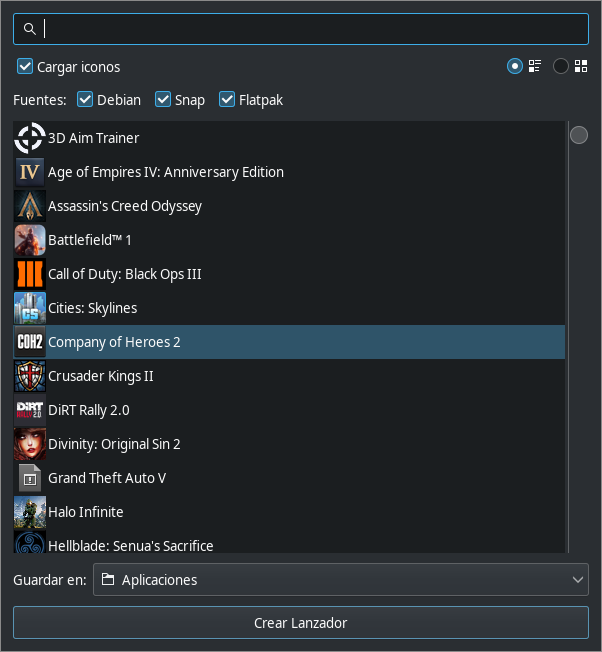

# Desktop Launcher Creator

Crea lanzadores de escritorio (`.desktop`) a partir de las aplicaciones ya
instaladas en tu sistema, detectando automáticamente paquetes **Debian**,
**Snap** y **Flatpak**.



## Características

- Detección de aplicaciones de **Debian**, **Snap** y **Flatpak**.
- Búsqueda instantánea por nombre.
- Vista de **lista** o de **cuadrícula**, con los iconos reales de cada app.
- Casilla para **cargar o no los iconos** (arranque más rápido si se desactiva).
- Selección de la carpeta de destino (por defecto `~/Aplicaciones`).
- Crea el lanzador con doble clic o con el botón **Crear Lanzador**.

## Requisitos

- Python 3.12+
- GTK 3 y PyGObject

### Dependencias del sistema (Debian/Ubuntu)

```bash
make deps
```

o manualmente:

```bash
sudo apt update
sudo apt install -y libgirepository-2.0-dev libgirepository1.0-dev gir1.2-gtk-3.0 libcairo2-dev
```

## Instalación y uso

```bash
make install   # instala las dependencias de Python con Poetry
make run       # ejecuta la aplicación
```

## Empaquetado

### Flatpak

El manifiesto está en `packaging/flatpak/`. Requiere `flatpak-builder`:

```bash
make flatpak-build     # compila en build-dir/
make flatpak-bundle    # genera dist/desktop-launcher-creator-<versión>.flatpak
make flatpak-install   # compila e instala para el usuario actual
```

### Snap

El `snapcraft.yaml` está en `packaging/snap/`. Requiere `snapcraft`:

```bash
make snap-build        # genera el .snap
make snap-lint         # valida el snapcraft.yaml
```

## Release

El flujo de release construye todos los artefactos y luego crea la etiqueta:

```bash
make release-local     # construye wheel + sdist + .flatpak + .snap en dist/
make release-push      # crea la etiqueta vX.Y.Z y la sube a gitea
make release           # ambos pasos
```

La versión se toma automáticamente de `pyproject.toml`. Los artefactos se
publican en la release de Gitea mediante Drone CI (paso `release`).

## Desarrollo

```bash
make test      # ejecuta las pruebas
make lint      # comprobaciones estáticas
make clean     # limpia artefactos
```

## Integración continua

- **GitHub Actions**: `.github/workflows/ci.yml` y `release.yml`.
- **Drone CI** (compatible con Gitea): `.drone.yml`.

Infraestructura:

| Servicio | URL |
|----------|-----|
| Repositorio (Gitea) | https://gitea.app.brisecom.net/gitea/desktop-launcher-creator |
| Drone CI | https://drone.app.brisecom.net |
| GitHub (espejo) | https://github.com/javi-jimenez/desktop-launcher-creator |

Para el release en Gitea, define el secreto `gitea_token` en Drone con un token
de acceso de Gitea.

## Licencia

Este proyecto se distribuye bajo la **GNU General Public License v3.0 o
posterior** (GPL-3.0-or-later). Consulta el archivo [LICENSE](LICENSE).
