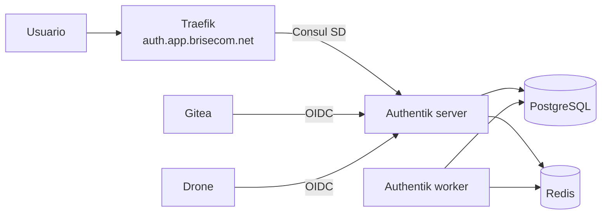

# Authentik — autenticación centralizada

Servidor de identidad ligero (OIDC/SAML/LDAP) para centralizar el login de
todos los servicios de `brisecom.net` (Gitea, Drone, y lo que venga).

> **Analogía**: Authentik es a Keycloak lo que Gitea es a GitLab — misma
> funcionalidad, muchos menos recursos.

## Arquitectura



## Prerrequisitos

- Nomad + Consul + Traefik funcionando.
- Un **PostgreSQL existente** con una base de datos `authentik` y su usuario.
- Redis disponible como `redis.service.consul` (o lanza `redis.nomad.hcl`).
- DNS: `auth.app.brisecom.net` → IP de Traefik.
- Traefik con `certresolver=letsencrypt` configurado (o ajusta el tag TLS).

## Preparar la base de datos

```sql
CREATE USER authentik WITH PASSWORD 'CAMBIAME';
CREATE DATABASE authentik OWNER authentik;
```

## Configurar secretos (Nomad Variables)

Authentik necesita dos secretos que **no** deben ir en el job:

```bash
nomad var put nomad/jobs/authentik \
  secret_key="$(openssl rand -base64 60)" \
  postgres_password="CAMBIAME"
```

Luego descomenta el bloque `template` en `authentik.nomad.hcl` para inyectarlos
como variables de entorno. (Alternativa: usar Vault con `template { data = ... }`.)

## Desplegar

```bash
# 1. Redis (solo si no tienes uno ya)
nomad job run deploy/authentik/redis.nomad.hcl

# 2. Authentik (server + worker)
nomad job run deploy/authentik/authentik.nomad.hcl

# Estado
nomad job status authentik
```

La primera vez, Authentik aplica las migraciones de base de datos
automáticamente. Espera a que el health check `/-/health/live/` pase a healthy.

## Primer acceso

1. Abre https://auth.app.brisecom.net
2. Usuario inicial: `akadmin` (contraseña temporal en los logs del server).
3. Cámbiala inmediatamente.

## Integrar Gitea (OIDC)

En Authentik: **Applications → Create with Provider → OAuth2/OpenID**.
- Redirect URI: `https://gitea.app.brisecom.net/user/oauth2/authentik/callback`
- Anota `Client ID` y `Client Secret`.

En Gitea (`app.ini` o UI → Authentication Sources → Add OAuth2):
```ini
[auth.oauth2.authentik]
name = Authentik
provider = openidConnect
client_id = <CLIENT_ID>
client_secret = <CLIENT_SECRET>
open_id_connect_auto_discovery_url = https://auth.app.brisecom.net/application/o/gitea/
```

## Integrar Drone (OIDC)

En Authentik crea otra aplicación OAuth2 con redirect URI:
`https://drone.app.brisecom.net/login`

En el servidor Drone (`drone-server` env):
```bash
DRONE_OAUTH2_CLIENT_ID=<CLIENT_ID>
DRONE_OAUTH2_CLIENT_SECRET=<CLIENT_SECRET>
DRONE_OAUTH2_SERVER=https://auth.app.brisecom.net/application/o/drone/
DRONE_OAUTH2_SCOPE=openid profile email
```

## Recursos estimados

| Componente | CPU | RAM |
|------------|-----|-----|
| Authentik server | 0.5 | 1 GB |
| Authentik worker | 0.5 | 1 GB |
| Redis (si propio) | 0.2 | 256 MB |

Frente a Keycloak (~1-2 GB solo el server), Authentik es notablemente más ligero.
